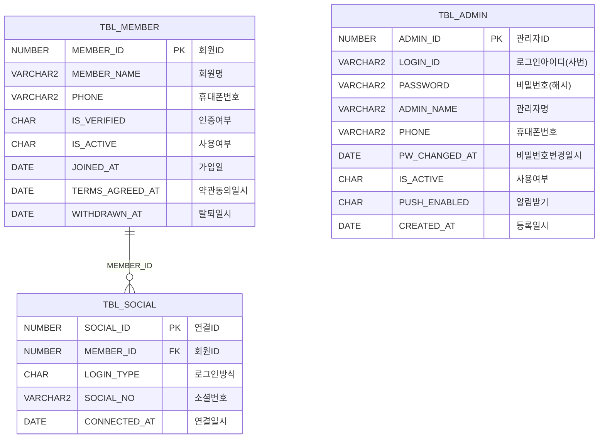
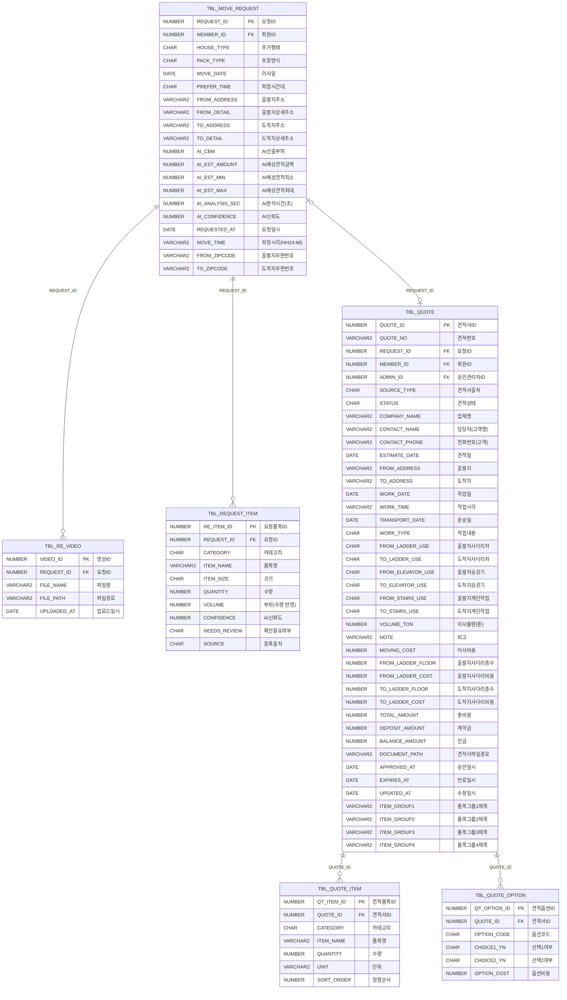
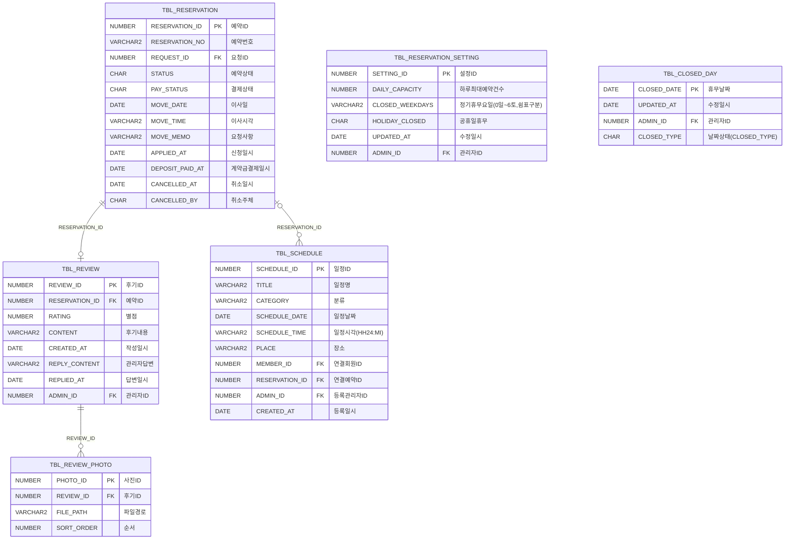
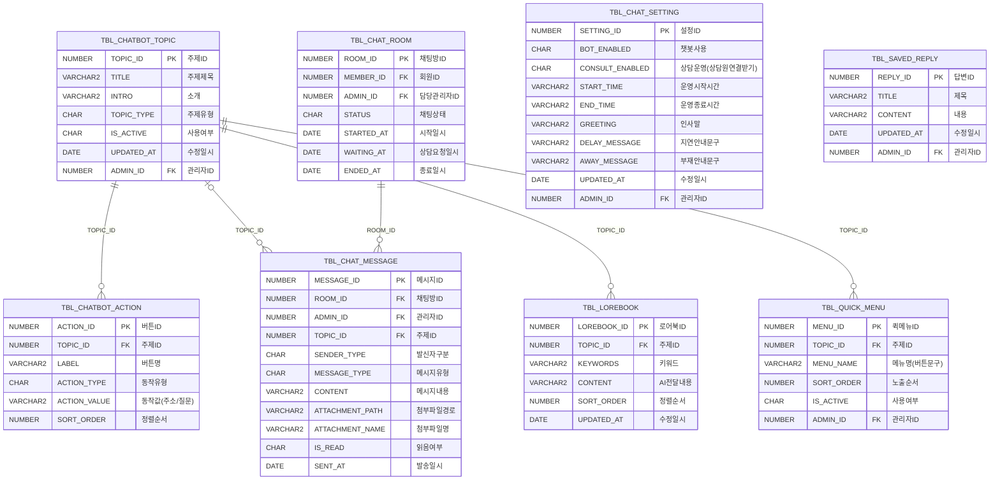
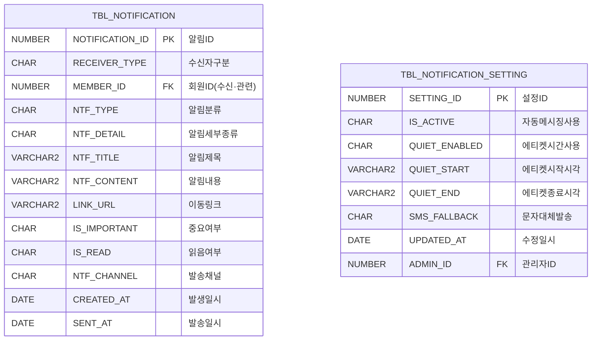
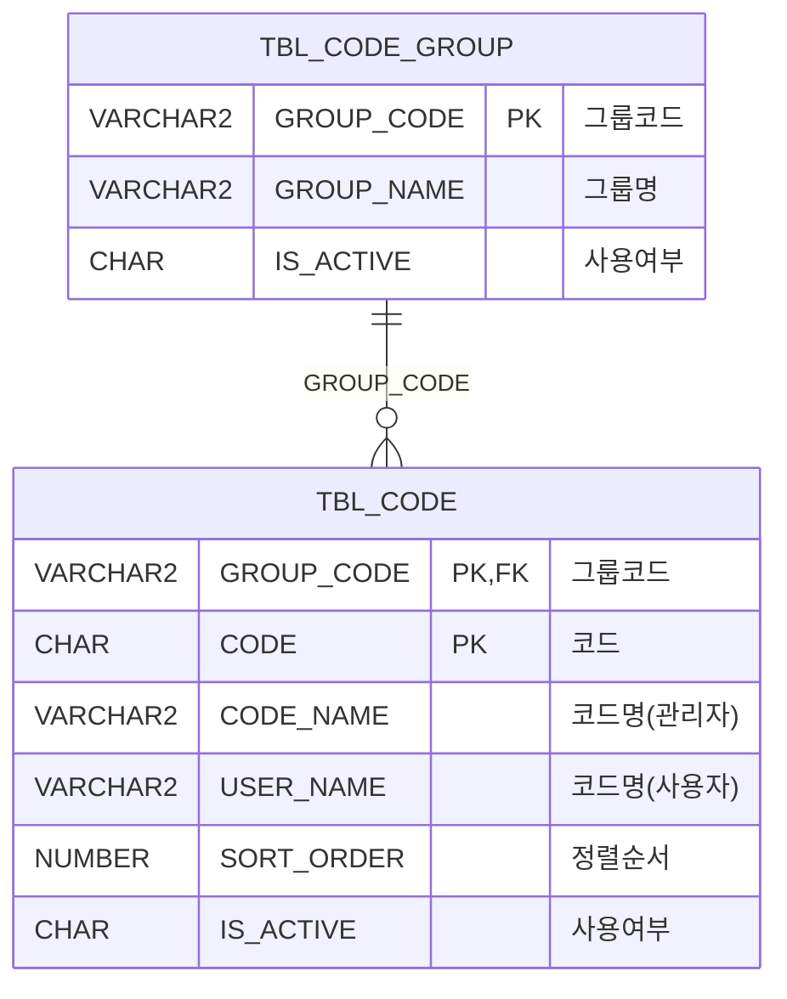
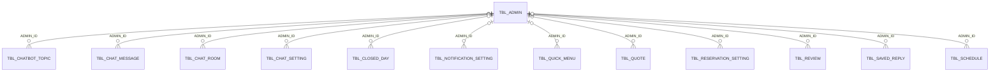

# ERD (화면 대조 반영, 2026-11-08)

TEAM03 DB(테이블 27개)의 데이터 사전에서 만든 그림입니다. DDL은 [`db/schema.sql`](../../db/schema.sql), 이전 ERD(`CodeMove_ERD.pdf`)와 달라진 점은 [ERD_CHANGES.md](ERD_CHANGES.md)에 있습니다.

- 관계선: `||--o{` 필수 1:N, `|o--o{` 선택(NULL 허용 FK) 1:N, `||--o|` 1:1(유니크 FK)
- 관리자 FK(`ADMIN_ID`, 마지막 수정·담당 관리자)는 그림이 복잡해져 각 영역 그림에서 생략하고 맨 아래에 따로 그렸습니다.

## 회원·로그인

## 견적 요청·견적서

다른 영역 참조: `TBL_MOVE_REQUEST.MEMBER_ID` → `TBL_MEMBER`, `TBL_QUOTE.MEMBER_ID` → `TBL_MEMBER`

## 예약·후기·일정

다른 영역 참조: `TBL_RESERVATION.REQUEST_ID` → `TBL_MOVE_REQUEST`, `TBL_SCHEDULE.MEMBER_ID` → `TBL_MEMBER`

## 챗봇·채팅

다른 영역 참조: `TBL_CHAT_ROOM.MEMBER_ID` → `TBL_MEMBER`

## 알림

다른 영역 참조: `TBL_NOTIFICATION.MEMBER_ID` → `TBL_MEMBER`

## 공통코드

## 관리자 참조

## 테이블 목록

| 영역 | 테이블 | 설명 |
| --- | --- | --- |
| 회원·로그인 | `TBL_MEMBER` | 회원 |
| 회원·로그인 | `TBL_SOCIAL` | 간편로그인 |
| 회원·로그인 | `TBL_ADMIN` | 관리자 |
| 견적 요청·견적서 | `TBL_MOVE_REQUEST` | 견적요청 |
| 견적 요청·견적서 | `TBL_RE_VIDEO` | 요청영상 |
| 견적 요청·견적서 | `TBL_REQUEST_ITEM` | 요청품목 |
| 견적 요청·견적서 | `TBL_QUOTE` | 견적서 |
| 견적 요청·견적서 | `TBL_QUOTE_ITEM` | 견적품목 |
| 견적 요청·견적서 | `TBL_QUOTE_OPTION` | 견적옵션 |
| 예약·후기·일정 | `TBL_RESERVATION` | 예약 |
| 예약·후기·일정 | `TBL_REVIEW` | 후기 |
| 예약·후기·일정 | `TBL_REVIEW_PHOTO` | 후기사진 |
| 예약·후기·일정 | `TBL_SCHEDULE` | 관리자일정 |
| 예약·후기·일정 | `TBL_RESERVATION_SETTING` | 예약설정 |
| 예약·후기·일정 | `TBL_CLOSED_DAY` | 임시휴무일 |
| 챗봇·채팅 | `TBL_CHATBOT_TOPIC` | 챗봇주제 |
| 챗봇·채팅 | `TBL_LOREBOOK` | 로어북 |
| 챗봇·채팅 | `TBL_CHATBOT_ACTION` | 챗봇답변버튼 |
| 챗봇·채팅 | `TBL_QUICK_MENU` | 퀵메뉴 |
| 챗봇·채팅 | `TBL_CHAT_ROOM` | 채팅방 |
| 챗봇·채팅 | `TBL_CHAT_MESSAGE` | 채팅메시지 |
| 챗봇·채팅 | `TBL_CHAT_SETTING` | 챗봇설정 |
| 챗봇·채팅 | `TBL_SAVED_REPLY` | 자주쓰는답변 |
| 알림 | `TBL_NOTIFICATION` | 알림 |
| 알림 | `TBL_NOTIFICATION_SETTING` | 알림설정 |
| 공통코드 | `TBL_CODE_GROUP` | 공통코드그룹 |
| 공통코드 | `TBL_CODE` | 공통코드 |
