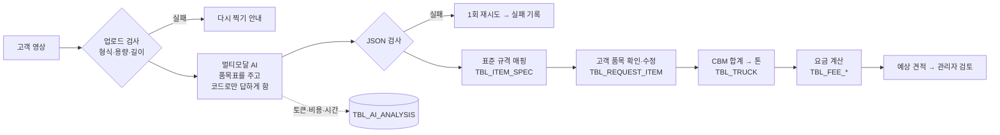
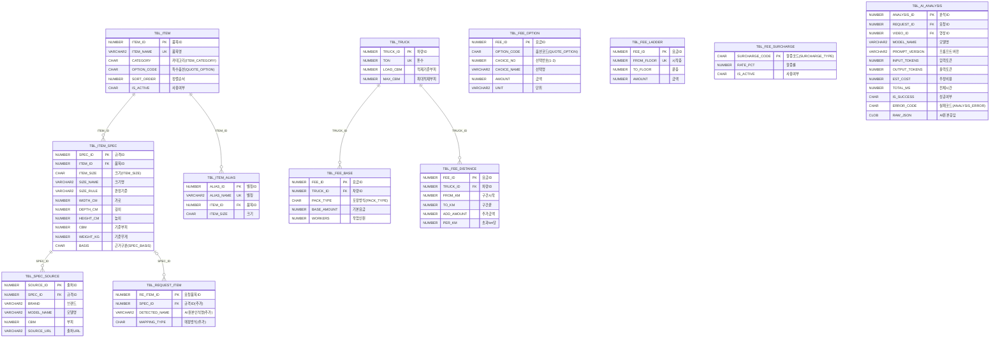

# AI 영상 견적 설계 (2026-11-20 제안, 11-23 구현·대표님 기준 반영)

고객이 찍은 집 영상으로 **품목 → 부피(CBM) → 차량(톤) → 견적 금액**을 내는 방법입니다. [codemove_video_test_guide.md](../../codemove_video_test_guide.md)의 1~6단계에 해당합니다.

**2026-11-23 변경 요약** (대표님 통화: [CALL_2026-11-23_견적방법.md](CALL_2026-11-23_견적방법.md))
- 구현: Gemini 영상 분석([estimate 패키지](../../src/main/java/com/codemove/estimate/)), 고객 견적 2단계 실제 분석, 6단계 서버 계산, 관리자 테스트 화면 `/admin/ai-test`(분석 기록·토큰·비용·정답 비교·예상 견적).
- 차량: 1톤 = **10 CBM**, 5톤 = **35 CBM**(대표님). 물품 부피 × **적재계수 2.0** = 적재 부피. 차량 조합은 5톤을 꽉 채우고 나머지를 1톤 2대 또는 1대로 ([4장](#4-견적-계산식)).
- 요금: 반포장·포장 1톤·2.5톤, 5톤 포장, 거리(50km마다), 에어컨·안마의자·벽걸이 TV(인치별)를 대표님 값으로 교체. 계약금 10%.
- 포장 방식: 고객 화면과 견적서 작업 내용을 **일반·반포장·포장·보관 4가지**로.
- 모델: `gemini-2.5-flash`는 신규 사용자에게 막혀 **`gemini-4-hydrogen`**(생각 수준 low)으로 변경.
- 분석 기록은 DB(V4) 적용 전까지 `ai-logs/` 폴더(JSON, Git 제외).

**2026-11-24 변경 요약**
- 통화에서 안 나온 값을 아정당 기준으로 채움 (5톤·7.5톤·10톤 포장, 반포장 = 포장 − 20만, 보관이사 × 1.5~2 + 보관료, 날짜 할증, 사다리차, 계단 인력). 근거: [통화 정리 6장](CALL_2026-11-23_견적방법.md#6-통화에서-안-나온-값--아정당-기준으로-채움-2026-11-24).
- 고객 화면 주소 단계에 **층수 + 나르는 방법(엘리베이터·사다리차·계단)**, 보관이사는 **보관 기간**. 견적서 초안의 운반방법·사다리 층수·사다리 금액·수작업(계단) 칸에 들어감.
- **이동 거리**: 카카오 로컬(주소 → 좌표) + 카카오모빌리티 길찾기([DistanceService](../../src/main/java/com/codemove/estimate/DistanceService.java)). 카카오 앱에서 '카카오맵' 사용을 켜야 동작하고, 꺼져 있으면 50km 미만으로 계산하고 안내 문구를 붙임.
- Gemini 주 모델이 혼잡(503)·한도(429)면 **예비 모델**(`codemove.ai.gemini.fallback-models`)로 자동 전환. 기록에 실제 쓴 모델이 남음. (아래 v3 항목에서 "마지막 시도에서만"으로 바꿈)
- **V4 DB 연결 코드**: V4가 적용되면([V4Schema](../../src/main/java/com/codemove/estimate/V4Schema.java)가 1분마다 확인) 분석 기록은 `TBL_AI_ANALYSIS`, 품목은 `SPEC_ID`·`DETECTED_NAME`·`MAPPING_TYPE`(고객이 고치거나 추가하면 05)까지 저장하고, 이사 요청이 끝나면 분석 기록을 요청·영상과 연결. 적용 전에는 지금처럼 파일 기록.
- V4 DDL 수정: 요금표를 차(TRUCK_ID)가 아니라 **짐 톤(TON)** 기준으로(7.5·10톤 행), 기본요금 상한 `MAX_AMOUNT`, `TBL_FEE_TV`·`TBL_ESTIMATE_RULE` 추가.
- 버그 수정: 날짜 할증의 손 없는 날 판정이 항상 거짓이던 문제(끝 날짜 미포함 범위에 같은 날을 넣음).

**2026-11-24 프롬프트 v3 · 안정성 확인** (사람 없는 집 영상 house-01-noperson, 정답 25.3 CBM / 7톤)

| 프롬프트 · 모델 | F1 | 물품 CBM | 짐 톤 |
|---|---|---|---|
| v2 · gemini-4-hydrogen (2번) | 77%, 78% | 19.5, 20.4 (약 −20%) | 6톤 |
| **v3 · gemini-4-hydrogen (2번)** | **90%, 91%** | **22.6, 22.7 (−11%, −10%)** | **7톤 (대표님 답과 같음)** |
| v3 · gemini-3.5-flash (예비 모델, 2번) | 64%, 42% | 16.5, 15.9 (약 −36%) | 5톤 |

- v3([prompt-v3.txt](../../src/main/resources/estimate/prompt-v3.txt)): 공간 목록 먼저 → 빈 공간 다시 보기, 의자·걸린 옷·서랍장 등 자주 빠뜨리는 짐 확인, 선반은 "면 × 단 × 가득/반"으로 바구니 계산, 세탁기·건조기 구분. 애매하면 빼지 말고 확인 필요로.
- 관리자 AI 테스트 화면에서 프롬프트 버전(v3·v2·v1)을 골라 비교할 수 있음.
- 결과가 흔들린 원인은 프롬프트가 아니라 **예비 모델로 자동 전환**된 것. 그래서 혼잡(503)이면 주 모델로 10초·20초 쉬었다가 다시 하고, **마지막 시도에서만** 예비 모델로 넘어가게 바꿈. 한도 초과(429)는 기다려도 풀리지 않아 바로 예비 모델로 넘어감. 예비 모델 결과에는 메모에 "빠진 짐이 있을 수 있으니 목록을 꼭 확인해 주세요"를 붙임.
- 무료 등급은 Hydrogen 하루 한도가 금방 찹니다(한국 시간 오후 5시 초기화). 실서비스는 유료 키가 필요합니다.

**테스트 영상 폴더** ([TestVideoFolder](../../src/main/java/com/codemove/estimate/TestVideoFolder.java))
- `application-local.yml` 의 `codemove.ai.test-video-dir` 에 폴더 경로를 적으면, 관리자 → AI 영상 분석 테스트 화면에 그 폴더의 영상(mp4·mov·webm)이 나타납니다. 영상을 폴더에 넣기만 하면 됩니다.
- 영상과 **같은 이름의 .csv**(예: `테스트 1.mp4` ↔ `테스트 1.csv`)를 두면 정답 목록으로 자동 비교합니다. 형식은 [testset/house-01.csv](testset/house-01.csv)와 같습니다(공간,품목명,크기코드,수량,본 물건,...). 엑셀에서 저장한 CP949 파일도 읽습니다. 줄이 잘못되면 화면에 몇 번째 줄인지 나옵니다.
- 영상마다 "분석", 또는 "전체 분석(뒤에서)"으로 폴더 전체를 하나씩 돌립니다. 한도 초과(429)가 나면 나머지는 멈춥니다.
- "영상별 결과"에 같은 영상 · 프롬프트 · 모델끼리 묶어 횟수, F1 평균(최소~최대), CBM 평균(최소~최대)을 보여 줍니다.

2026-11-24 유료 키로 v3 · gemini-4-hydrogen 전체 분석 3번 (영상 2개 89초 안팎):

| 영상 | F1 | 물품 CBM | 짐 톤 |
|---|---|---|---|
| 테스트 2 (= house-01 원본, 사람 장면 포함, 정답 26.8) | 81 · 89 · 83 (평균 84) | 20.7 · 22.6 · 27.2 | 6 · 7 · 7톤 |
| 테스트 1 (거실 17초, 정답 아직 없음) | - | 10.6 · 10.1 · 9.6 | 3.5 · 2 · 2톤 |

- 상태: 요금·규격 계산은 CSV를 직접 읽습니다(CSV가 원본, `py -3 db/tools/gen_v4_data.py`로 DB 데이터 SQL 생성). V4 DDL은 11-24에 CSV와 맞췄고, **2026-11-24 TEAM03에 적용**했습니다(DDL 169문 → data 357문, 추가만). 요금을 바꿀 때는 CSV를 고치고 data SQL을 다시 만든 뒤, 해당 테이블 행을 지우고 다시 넣습니다. DDL은 [V4__item_spec_and_fee.ddl.sql](../../db/migration/V4__item_spec_and_fee.ddl.sql), 초기 데이터는 [V4__item_spec_and_fee.data.sql](../../db/migration/V4__item_spec_and_fee.data.sql)에 있습니다.
- 값의 원본은 [data/](data/) 폴더의 CSV입니다. 값을 바꿀 때는 CSV만 고치고 `py -3 db/tools/gen_v4_data.py`로 data SQL을 다시 만듭니다.
- `[업체 확인]`이 붙은 값은 인터넷 시세나 가정으로 채운 값입니다. 대표님께 확인받기 전에는 실제 견적에 쓰지 않습니다. 확인할 질문은 [7장](#7-업체대표님-확인-질문)에 모았습니다.

## 1. 전체 흐름



AI는 **보이는 품목과 개수, 크기 등급만** 답합니다. 부피·톤·금액은 서버가 DB 표로 계산합니다. 그래서 같은 품목 목록이면 항상 같은 금액이 나오고, 요금이 바뀌어도 AI 프롬프트는 고칠 필요가 없습니다.

## 2. 영상 분석 AI를 만드는 방법

AI 모델을 직접 학습시키지 않고, **영상을 그대로 받는 멀티모달 생성형 AI API**를 씁니다. 가이드 문서도 이 방식을 전제로 합니다.

### 2.1 핵심: AI에게 우리 품목표를 주고 그중에서만 고르게 한다

AI가 "양문형 냉장고", "큰 냉장고", "LG 냉장고"처럼 제각각 답하면 DB와 맞추기 어렵습니다. 그래서 프롬프트에 `TBL_ITEM` + `TBL_ITEM_SPEC`의 **품목명·크기코드·판정기준**을 넣고, 응답은 그 코드로만 받습니다.

프롬프트에 넣는 품목표 (DB에서 만들어 붙임, 31개 품목 × 3개 크기):

```text
품목명 | 01 | 02 | 03
침대 | 싱글: 폭 1m 안팎, 1인용 | 슈퍼싱글~퀸: 폭 1.1~1.6m | 킹 이상: 폭 1.7m 이상 또는 수납·헤드 대형 프레임
냉장고 | 1도어·소형: 허리 높이 이하 | 일반 2도어: 위아래 2도어 | 양문형·4도어: 좌우로 열리는 대형
...
```

지시 사항 (프롬프트 버전 `v1`):

1. 영상에 **실제로 보이는** 이삿짐만 적는다. 보이지 않는 물건을 추측해서 넣지 않는다.
2. 같은 물건이 여러 장면에 나와도 **한 번만** 센다. 방을 옮겨 다시 나오면 위치·색·모양으로 같은 물건인지 판단한다.
3. 품목표에 있으면 `item_name`과 `size_code`를 표 그대로 쓴다. 없으면 `item_name`은 `"기타"`, `detected_name`에 본 이름을 적는다.
4. 크기가 애매하면 가까운 등급을 고르고 `needs_review: true`로 둔다.
5. 붙박이장·시스템 에어컨처럼 건물에 고정된 것은 넣지 않는다.
6. 작은 짐(책, 옷, 그릇)은 낱개로 세지 않고 이사박스 개수로 추정한다.

응답 형식 (API의 JSON 스키마 강제 기능을 사용):

```json
{
  "video_ok": true,
  "reject_reason": null,
  "rooms": ["거실", "안방", "주방"],
  "items": [
    { "item_name": "냉장고", "size_code": "03", "quantity": 1,
      "detected_name": "양문형 냉장고", "evidence": "주방, 좌우로 열리는 문 2개", "needs_review": false },
    { "item_name": "소파", "size_code": "02", "quantity": 1,
      "detected_name": "3인용 패브릭 소파", "evidence": "거실, 쿠션 3개", "needs_review": false },
    { "item_name": "이사박스", "size_code": "02", "quantity": 12,
      "detected_name": "책·옷 등 잔짐", "evidence": "책장 2칸, 행거 옷", "needs_review": true }
  ]
}
```

- `video_ok: false`면 `reject_reason`에 `"집 안 영상 아님"`, `"너무 어두움"` 같은 이유를 적게 합니다 → [6장 예외 처리](#6-예외-처리).
- 서버 검사: `item_name`은 품목표 또는 `"기타"`, `size_code`는 `01~03`, `quantity`는 1~200 정수. 어긋나면 그 품목은 `needs_review`로 바꿉니다.
- 가이드 4장대로 AI가 주는 신뢰도 숫자는 확률로 보지 않습니다. 대신 `needs_review`와 매핑 방식으로 확인 필요 여부를 정합니다.

### 2.2 모델 선택

| 후보 | 방식 | 장점 | 단점 |
| --- | --- | --- | --- |
| **Gemini (1순위)** | 영상 파일을 그대로 전송 | 영상 입력이 기본 기능. 프레임을 직접 뽑을 필요 없음. JSON 스키마 강제 지원 | 영상 길이에 비례해 토큰이 늘어남 |
| 이미지 모델(Claude·GPT 등) | 서버에서 ffmpeg로 1~2초마다 프레임을 뽑아 이미지 여러 장으로 전송 | 모델을 바꿔 비교하기 쉬움. 보낼 장면 수를 직접 조절 | 프레임 추출 단계가 더 필요. 장면 사이 중복 판단이 약할 수 있음 |

- 1차 구현은 Gemini 하나로 하고, 비교 모델은 7단계(반복 테스트)에서 같은 영상으로 돌려 봅니다.
- 영상 토큰은 대략 **영상 1초당 수백 토큰**입니다(Gemini 기본 해상도 기준, 낮은 해상도 옵션이 있음). 1분 영상이면 입력 2만 토큰 안팎이 됩니다. 정확한 값은 응답의 사용량(usage) 정보를 `TBL_AI_ANALYSIS`에 그대로 저장해서 확인합니다. 모델명과 단가는 공식 요금표를 보고 `PRICE_IN`·`PRICE_OUT`·`PRICE_DATE`에 기록합니다.
- 고객 촬영 안내: **1~3분, 방마다 천천히 한 바퀴, 불 켜고 촬영, 문 닫힌 수납장은 열어서**. 업로드 한도는 200MB·5분으로 시작해 실측 후 조정합니다.
- API 키는 서버 환경변수로만 관리합니다(`application.yml`에 직접 쓰지 않음).

### 2.3 매핑 순서 (ItemMappingService)

AI가 품목표 코드로 답하므로 대부분 1번에서 끝납니다.

| 순서 | 방법 | `MAPPING_TYPE` | 확인 필요 |
| --- | --- | --- | --- |
| 1 | `item_name` = `TBL_ITEM.ITEM_NAME` 정확 일치 | 01 정확 일치 | AI가 `needs_review`라고 한 것만 |
| 2 | `detected_name`을 `TBL_ITEM_ALIAS`에서 찾음 (별칭에 크기가 있으면 크기도 채움) | 02 별칭 | 크기를 별칭에서 못 정하면 Y |
| 3 | 품목은 찾았는데 크기 코드가 없거나 잘못됨 → 중형(02)으로 두고 | 03 AI 후보 | Y |
| 4 | 못 찾음(`"기타"`) → 규격 없이 저장, 부피 0으로 두고 관리자에게 넘김 | 04 미매핑 | Y |
| - | 고객·관리자가 화면에서 고침 | 05 사용자 수정 | N |

매핑 결과는 `TBL_REQUEST_ITEM`에 `SPEC_ID`, `DETECTED_NAME`(AI 원본 이름), `MAPPING_TYPE`을 함께 저장합니다. 기존 컬럼(`ITEM_NAME`, `ITEM_SIZE`, `VOLUME`, `NEEDS_REVIEW`, `SOURCE`)은 지금처럼 채웁니다.

## 3. 테이블 설계

모두 새로 추가하는 테이블이고, 기존 테이블은 `TBL_REQUEST_ITEM`에 NULL 허용 컬럼 3개만 추가합니다. 코드는 기존 공통코드(`ITEM_CATEGORY`, `ITEM_SIZE`, `PACK_TYPE`, `QUOTE_OPTION`)를 그대로 씁니다.



다른 영역 참조: `TBL_AI_ANALYSIS.REQUEST_ID` → `TBL_MOVE_REQUEST`, `VIDEO_ID` → `TBL_RE_VIDEO`. 요금 테이블의 `ADMIN_ID`(수정 관리자) → `TBL_ADMIN`.

| 팀 메모 항목 | 테이블 | 데이터 파일 | 건수 |
| --- | --- | --- | --- |
| 어떤 품목이 있는지 (가전·가구 카테고리 매핑) | `TBL_ITEM` | [item-master.csv](data/item-master.csv) | 31 |
| 품목 크기별 기준값(CBM) | `TBL_ITEM_SPEC` | 〃 | 93 |
| 기준값 근거(제조사 모델 치수) | `TBL_SPEC_SOURCE` | [cbm-sources.csv](data/cbm-sources.csv) | 89 |
| AI·고객이 쓰는 다른 이름 | `TBL_ITEM_ALIAS` | [item-alias.csv](data/item-alias.csv) | 40 |
| CBM → 톤 환산(차량 적재 기준) | `TBL_TRUCK` | [truck-capacity.csv](data/truck-capacity.csv) | 3 |
| 기본 요금: 톤 × 포장 방식 | `TBL_FEE_BASE` | [fee-base.csv](data/fee-base.csv) | 9 |
| 특수품목 요금 | `TBL_FEE_OPTION` | [fee-option.csv](data/fee-option.csv) | 16 |
| 거리 추가 요금 | `TBL_FEE_DISTANCE` | [fee-distance.csv](data/fee-distance.csv) | 15 |
| 날짜 할증(손 없는 날 등) | `TBL_FEE_SURCHARGE` | [fee-surcharge.csv](data/fee-surcharge.csv) | 4 |
| 사다리차 | `TBL_FEE_LADDER` | [fee-ladder.csv](data/fee-ladder.csv) | 8 |
| 영상 분석 토큰·비용·시간 기록 | `TBL_AI_ANALYSIS` | - | - |

새 공통코드 그룹: `SPEC_BASIS`(규격 근거), `SURCHARGE_TYPE`(날짜 할증), `MAPPING_TYPE`(매핑 방식), `ANALYSIS_ERROR`(분석 실패).

설계 메모:

- **특수품목 요금**은 견적서 양식의 옵션 8종(`QUOTE_OPTION`)과 선택1·선택2(예: 에어컨 탈착/설치)를 그대로 따릅니다. 계산 결과는 기존 `TBL_QUOTE_OPTION.OPTION_COST`에 들어갑니다. 품목에 `OPTION_CODE`가 있으면(피아노 01, 안마의자 07, 에어컨 08) AI가 그 품목을 찾았을 때 옵션을 자동으로 켭니다.
- **거리 요금**은 택시처럼 km마다 오르는 방식이 아니라, 업계 시세가 구간제(50km까지 기본 포함, 50~100km, 100~150km …)라서 구간 표로 만들었습니다. 마지막 구간(200km 초과)만 km당 단가를 씁니다.
- **사다리차**는 출발지와 도착지에 따로 적용하고, 결과는 기존 `TBL_QUOTE.FROM_LADDER_COST`·`TO_LADDER_COST`에 들어갑니다. 25층 이상은 금액을 비워 두고 "별도 협의"로 표시합니다.
- **무게**: 가이드는 무게 산정도 요구하지만, 팀원 표에 무게 자료가 없어 `WEIGHT_KG`는 비워 두었습니다. 견적 금액에는 쓰지 않으므로 나중에 채워도 됩니다.
- **손 없는 날**: 음력 끝자리 9·0인 날입니다. [LunarDays.java](../../src/main/java/com/codemove/common/LunarDays.java)가 ICU4J의 한국 음력(`DangiCalendar`, 한국 시간 기준)으로 계산하고, 관리자 일정 달력(음력 날짜도 표시)과 고객 견적 달력(파란 점)이 이 함수를 씁니다. 날짜 할증도 요금 확정 후 같은 함수를 씁니다. (2026-11-20 적용)

## 4. 견적 계산식

구현: [EstimateCalculator.java](../../src/main/java/com/codemove/estimate/EstimateCalculator.java), 테스트: [EstimateCalculatorTest.java](../../src/test/java/com/codemove/estimate/EstimateCalculatorTest.java).

```text
① 물품 부피   = Σ (품목 규격 CBM × 수량)                          item-master.csv
② 적재 부피   = ① × 적재계수 2.0                                   estimate-rules.csv
③ 짐 톤수     = 5톤(35 CBM)을 꽉 채우고, 남은 짐은 "1톤 2대"와        truck-capacity.csv
                "들어가는 가장 작은 차 1대" 중 톤 합이 작은 쪽          (1톤 10 · 2.5톤 20 · 3.5톤 25 · 5톤 35)
                예) 55 CBM → 5톤 + 1톤 + 1톤 = 7톤 (대표님 우리 집)
④ 기본 요금   = 톤 × 포장 방식, 최소~최대 (표에 없는 톤은 앞뒤 비율)  fee-base.csv
⑤ 거리 추가   = 50km마다 톤별 금액                                  fee-distance.csv
⑥ 나르는 방법 = 사다리차 층수 금액 · 계단 3개 층마다 인력 15~20만      fee-ladder.csv, estimate-rules.csv
                (엘리베이터 이용료 5~10만은 관리사무소에 고객이 내므로 안내만)
보관이사      = 포장 × 1.5~2배 + 보관료(5톤 하루 7천~1만, 톤 비례 × 일수)   estimate-rules.csv
⑦ 옵션        = 에어컨 25만/대 · 안마의자 10만/대 · 벽걸이 TV 인치별 · 피아노   fee-option.csv, fee-tv.csv
⑧ 날짜 할증   = ④ × 해당 할증률 중 가장 큰 값                        fee-surcharge.csv [업체 확인]
예상 견적     = ④ + ⑤ + ⑥ + ⑦ + ⑧ (최소~최대, 만 원 단위), 계약금 10%
```

- **적재계수 2.0 근거** (근거 2가지가 거의 같음): ① 바구니(55×40×35cm = 0.077 CBM)가 1톤(10 CBM)에 50~70개 → 개당 적재 0.14~0.2 CBM으로 약 2배. ② 우리 집 정답 목록의 물품 부피 약 26 CBM이 대표님 견적 55 CBM의 약 절반. 포장재, 쌓을 때 빈 공간, 서랍·수납장에서 꺼낸 짐이 여기에 들어갑니다. 표본이 1집이므로 영상이 늘면 다시 맞춥니다.
- "톤"은 차가 아니라 **짐 양**이라 요금은 톤 합으로 냅니다(대표님).
- 고객 화면은 아직 거리·층수를 받지 않아 50km 미만·사다리차 없음으로 계산하고, 안내 문구로 알립니다.
- 날짜 할증은 통화에서 다루지 않아 기존 가정("기본 요금에만, 가장 큰 것 하나")을 유지합니다 [업체 확인].
- 이동 거리는 카카오 길찾기 API(자동차 경로 거리)로 구할 예정입니다. 지금은 받지 않습니다.
- 금액은 표의 최소~최대를 그대로 범위로 보여 줍니다(대표님: "얼마에서 얼마"). 고객 화면의 한 금액과 견적서 금액은 가운데 값입니다.

### 계산 예시: 대표님 우리 집

| 단계 | 계산 | 결과 |
| --- | --- | --- |
| ①② 부피 | 물품 약 27.5 CBM × 2.0 | 적재 55 CBM |
| ③ 짐 톤수 | 5톤(35) + 남은 20 → 1톤 2대(2톤) < 2.5톤 | **5톤 + 1톤 + 1톤 = 7톤** (대표님 견적과 같음) |
| ④ 포장 7톤 | 2.5톤 100~110만 · 5톤 140~160만의 기울기로 늘림 | 172만 ~ 200만 원 [업체 확인] |
| 계약금 | 가운데 186만 원 × 10% | 18.6만 원 |

이 예시는 [EstimateCalculatorTest](../../src/test/java/com/codemove/estimate/EstimateCalculatorTest.java)의 `dadsHouseExample55CbmIsFiveTonPlusTwoOneTon`·`sevenTonExtrapolatesFromTheTable`로 고정해 두었습니다.

## 5. 기존 코드와 연결되는 곳

| 전 | 지금 (2026-11-23) |
| --- | --- |
| [AiDemo.java](../../src/main/java/com/codemove/customer/web/AiDemo.java) 고정 인식 결과 | `/quote/analyze`([QuoteAnalysisController](../../src/main/java/com/codemove/customer/web/QuoteAnalysisController.java))가 실제 분석. API 키가 없을 때만 시연 품목 |
| quote.js 3초 가짜 분석 | 영상 업로드 → 진행 문구 → 결과·AI 메모, 실패 시 다시 분석 / 직접 입력 |
| MoveService 10만 원 + CBM × 2.4만 원 | `EstimateCalculator` (고객 6단계 `/quote/estimate`, 이사 요청 저장, 관리자 견적서 초안이 모두 같은 계산) |
| QuoteService `1톤 ≈ 5CBM` | 견적서 초안에 톤수·이사비용·옵션(에어컨·안마의자·벽걸이 TV·피아노)·계산 근거 메모를 채움 |
| `TBL_MOVE_REQUEST.AI_ANALYSIS_SEC` 38초 고정 | 실제 분석 시간 |
| 포장 방식 일반·반포장 2가지 | 고객 화면·견적서 모두 일반·반포장·포장·보관 4가지 |

## 6. 예외 처리

| 상황 | 판단 위치 | 고객 안내 | `ERROR_CODE` |
| --- | --- | --- | --- |
| mp4·mov·webm 아님 | 업로드 | "동영상 파일만 올릴 수 있어요" | 01 |
| 200MB 또는 5분 초과, 5초 미만 | 업로드 | "1~3분 길이로 다시 찍어 주세요" | 02 |
| 너무 어둡거나 흔들려서 판단 불가 | AI `video_ok:false` | "불을 켜고 천천히 다시 찍어 주세요" | 03 |
| 집 안 영상이 아님, 품목 0개 | AI `video_ok:false` 또는 items 비어 있음 | "집 안 가구·가전이 보이게 찍어 주세요" | 04 |
| AI 응답 시간 초과(90초) | API | 1회 재시도 후 "잠시 후 다시 시도" + 품목 직접 입력 버튼 | 05 |
| AI 사용량 한도(429) | API | 위와 같음 | 06 |
| JSON 형식이 깨짐 | 서버 검사 | 1회 재시도, 그래도 실패면 05와 같게 | 07 |
| 그 밖의 API 오류 | API | 위와 같음 | 08 |
| 품목은 찾았지만 표에 없음 | 매핑 | 품목 목록에 "확인 필요"로 보여 주고 고객이 고르거나 지움 | (실패 아님, `MAPPING_TYPE` 04) |

AI가 실패해도 고객은 **품목을 직접 추가해서 견적을 계속** 받을 수 있게 합니다(기존 `ITEM_SOURCE` 02 사용자 추가). 실패한 요청도 비용 계산에 들어가므로 모두 `TBL_AI_ANALYSIS`에 남깁니다.

## 7. 업체(대표님) 확인 질문

요금 표의 값과 계산 규칙은 이 답을 받아 확정합니다.

> **2026-11-23 통화로 답을 받은 것**: 1(1톤·2.5톤 반포장·포장, 5톤 포장), 2(톤을 먼저 정함, 짐 양 기준), 3(5톤 + 1톤 2대처럼 조합), 5(1톤 10·5톤 35 CBM), 6(바구니 50~70개 = 1톤), 7(50km마다), 10(안마의자·에어컨·벽걸이 TV·모션 침대). 자세한 값은 [통화 정리](CALL_2026-11-23_견적방법.md). **남은 것**: 4(보관료), 8·9(사다리차·계단), 11~13(날짜 할증), 2.5톤·3.5톤 CBM, 6톤 이상 요금.

**기본 요금**
1. 1톤·2.5톤·5톤 × 일반·반포장·포장 기본 요금은 얼마인가요? ([fee-base.csv](data/fee-base.csv)의 가정값을 보여 드리고 고쳐 받기)
2. 견적을 낼 때 톤수를 먼저 정하나요, 작업 인원 수를 먼저 정하나요? 인원 1명 추가는 얼마인가요?
3. 5톤을 넘으면 차를 어떻게 조합하나요(5톤 + 1톤, 5톤 2대 등)? 요금은 각 차 요금의 합인가요?
4. 보관이사(`PACK_TYPE` 03)는 보관료를 하루·한 달 중 어떤 단위로 받나요?

**짐 양**
5. 1톤·2.5톤·5톤 차에 이삿짐이 실제로 몇 CBM 정도 들어가나요? (또는 원룸·투룸·쓰리룸이 보통 몇 톤인가요?)
6. 이사 바구니 1개에 짐이 어느 정도 들어가나요? 바구니 크기(가로·세로·높이)와 원룸·투룸·쓰리룸에 보통 몇 개 쓰나요?

**추가 요금**
7. 거리가 멀면 추가 요금을 어떻게 받나요? 구간(예: 50km마다)인가요, km당인가요? 어디까지가 시내 기본인가요?
8. 사다리차 요금을 층수별로 알려 주세요. 1톤·2.5톤처럼 짐이 적으면 더 싼가요?
9. 엘리베이터가 없는 계단 작업은 층마다 얼마를 더 받나요?
10. 피아노·돌침대·조립장·벽걸이TV·홈씨어터·안마의자·에어컨의 분해·설치 비용은요? 에어컨은 직접 하시나요, 기사님을 부르시나요?

**날짜 할증**
11. 손 없는 날·주말·공휴일·월말에 몇 % 더 받나요? 겹치면(손 없는 날이면서 토요일) 더하나요, 큰 것 하나만 받나요?
12. 할증은 기본 요금에만 붙나요, 사다리차·옵션까지 포함한 전체에 붙나요?
13. 성수기(2~3월, 이사 많은 달)에도 할증이 있나요?

## 8. 데이터 근거

- 품목·크기·CBM: 팀원 조사 표. 가전·침대·소파·옷장은 제조사·판매처 모델 치수의 중간값([cbm-sources.csv](data/cbm-sources.csv)), 나머지는 가정값입니다.
- 톤별 기본 요금·거리별 요금: 아정당 [2.5톤, 5톤 예상 견적](https://www.ajd.co.kr/contents/basic-tip/detail/2.5%ED%86%A4,_5%ED%86%A4_%EC%98%88%EC%83%81_%EA%B2%AC%EC%A0%81%EC%9D%80_%EC%96%BC%EB%A7%88%EC%9D%BC%EA%B9%8C%EC%9A%94_%ED%8A%B8%EB%9F%AD%EC%9D%B4%EC%82%AC_%EB%B9%84%EC%9A%A9_%EC%95%8C%EC%95%84%EB%B3%B4%EA%B8%B0-42748) (2025-10-27 갱신), [포장이사 톤수별](https://miso.kr/blog/포장이사-톤수별), 이사 중개업체 블로그의 톤별 포장·반포장·일반 시세.
- 사다리차: 아정당 [포장이사 사다리차 비용 요금표](https://www.ajd.co.kr/contents/basic-tip/detail/%ED%8F%AC%EC%9E%A5%EC%9D%B4%EC%82%AC_%EC%82%AC%EB%8B%A4%EB%A6%AC%EC%B0%A8_%EB%B9%84%EC%9A%A9_%EC%9A%94%EA%B8%88%ED%91%9C_%ED%95%9C%EB%88%88%EC%97%90_%EB%B3%B4%EA%B8%B0_%EC%89%BD%EA%B2%8C-47059) (2026-05-29 갱신, 5톤 기준 2~5층 15만·14층 20만·20층 28만·24층 40만 원). 사이 층은 보간한 가정값입니다.
- 특수품목: 숨고 피아노 운반 평균(약 14.4만 원), 에어컨 이전설치 평균(약 18만 원). 나머지는 가정값입니다.
- 날짜 할증: 팀 메모(손 없는 날 10~20%)와 아정당(손 없는 날·주말 20~30%).
- 차량 적재 CBM: 공인 기준이 없어 탑차 적재함 치수 × 적재율 0.7로 계산한 가정값입니다. 1톤은 기존 코드의 1톤 ≈ 5CBM에 맞췄습니다.

인터넷 시세는 업체 홍보 글이 많고 출처마다 차이가 커서(예: 5톤 포장이사 95만~130만 원) 업체 확인 전에는 실제 견적에 쓰지 않습니다.

## 9. 다음 단계 (가이드 8단계 기준)

| 가이드 단계 | 상태 (2026-11-23) | 남은 일 |
| --- | --- | --- |
| 1. 기존 프로젝트 분석 | 완료 (3·5장) | 팀 확인 |
| 2. 테스트 화면·업로드 | **완료**: `/admin/ai-test` (관리자 메뉴 "AI 영상 분석 테스트") | 영상 길이 검사(지금은 형식·용량만) |
| 3. AI API 연동 | **완료**: [GeminiVideoAnalyzer](../../src/main/java/com/codemove/estimate/GeminiVideoAnalyzer.java), JSON 스키마 강제, 재시도(시간 초과·JSON 1회, 5xx 혼잡 2회), 업로드 영상 삭제 | 비동기 처리(지금은 요청이 끝날 때까지 기다림), 유료 등급 |
| 4. DB 자동 매핑 | **완료**: [ItemMatcher](../../src/main/java/com/codemove/estimate/ItemMatcher.java) (정확 일치 → 별칭 → 미매핑) | V4 적용 후 CSV → DB 조회 |
| 5. 부피 산정·견적 | **완료**: [EstimateCalculator](../../src/main/java/com/codemove/estimate/EstimateCalculator.java) + 테스트 11개, 층수·나르는 방법·보관 기간·거리 | 무게(자료 없음), 카카오맵 사용 켜기 |
| 6. 토큰·비용·시간 기록 | **완료**: `TBL_AI_ANALYSIS` (11-24 이전 기록은 `ai-logs/` 파일, 관리자 화면에 함께 표시) | - |
| 7. 반복 테스트·비교 | 시작: 정답 목록 [house-01](testset/house-01.csv) 1개, 관리자 화면에서 정밀도·재현율·CBM 오차 | 영상 5~10개 더, 모델·프롬프트별 비교 |
| 8. 기존 견적 통합 | **완료**: 고객 2·4·6단계, 이사 요청 저장(V4면 매핑방식 05 포함), 관리자 견적서 초안 | - |
